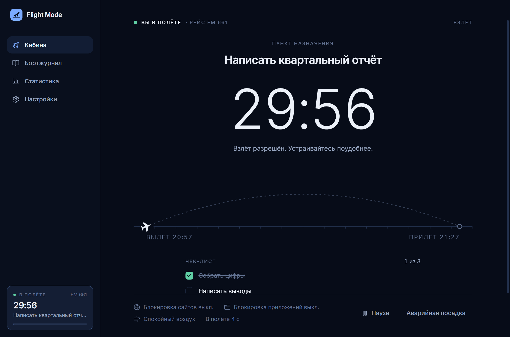
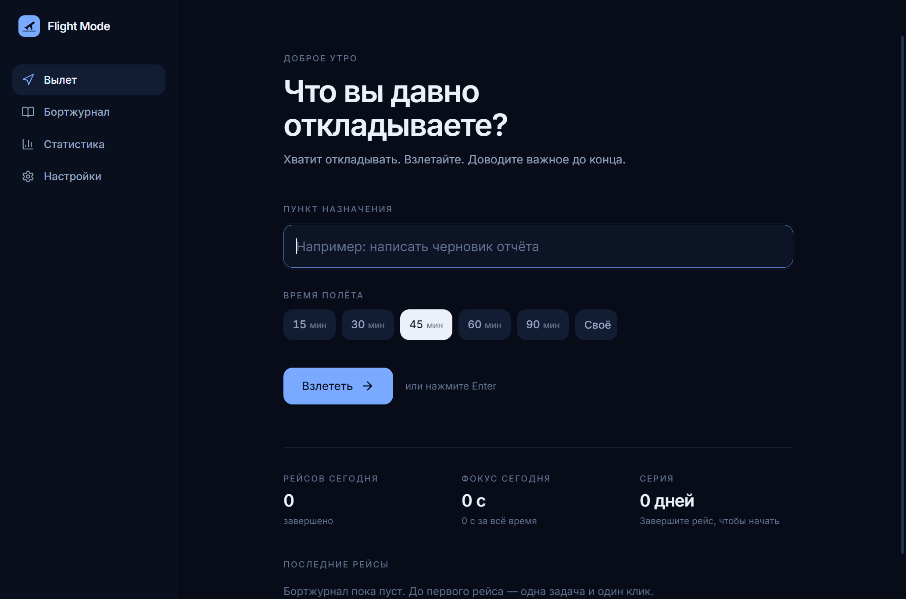
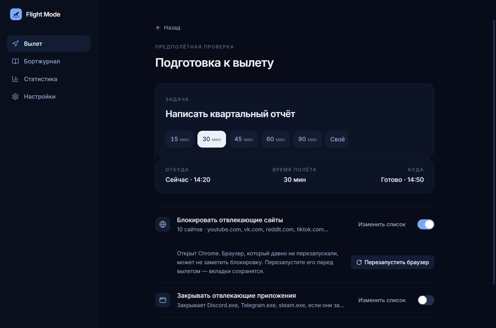
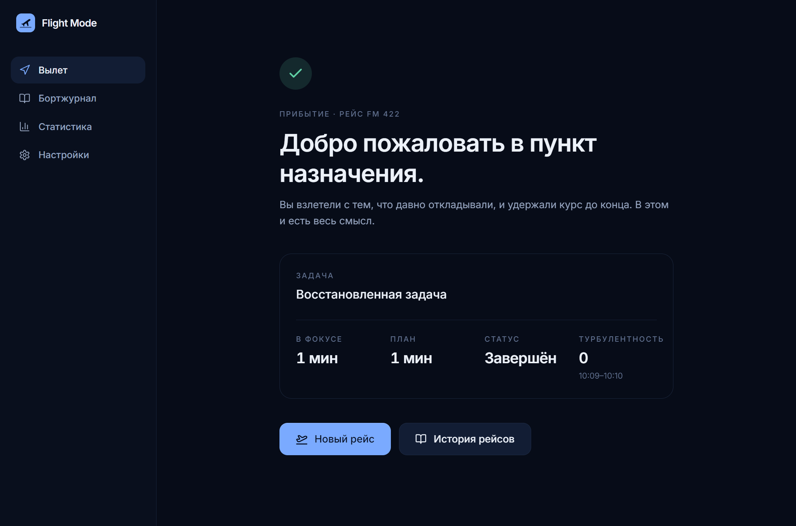
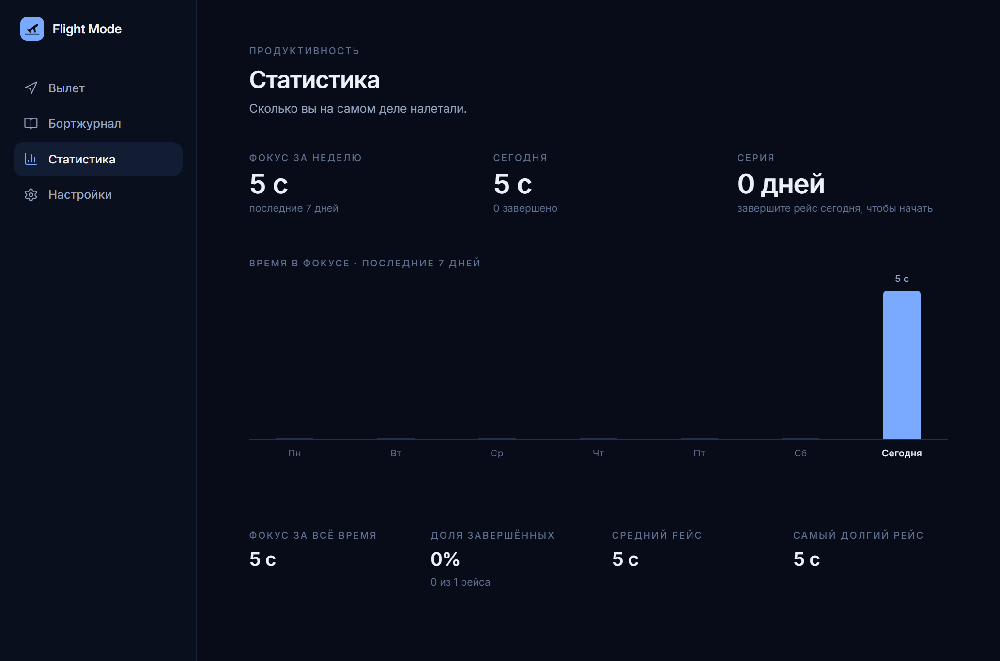
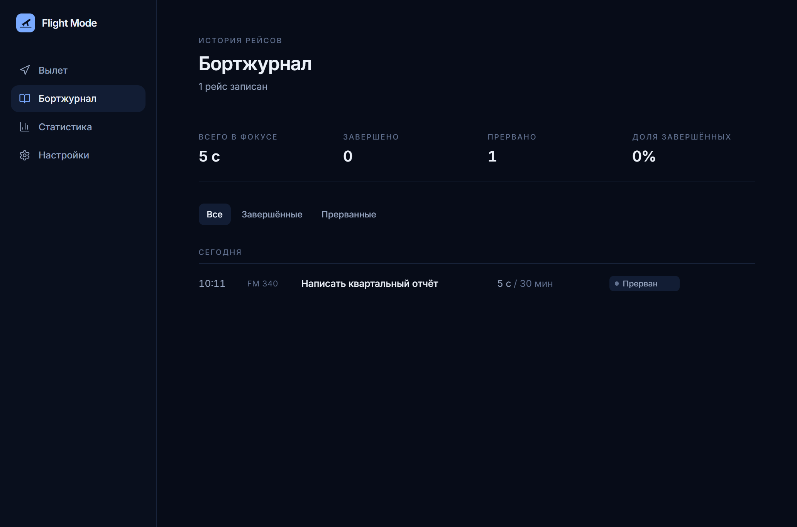
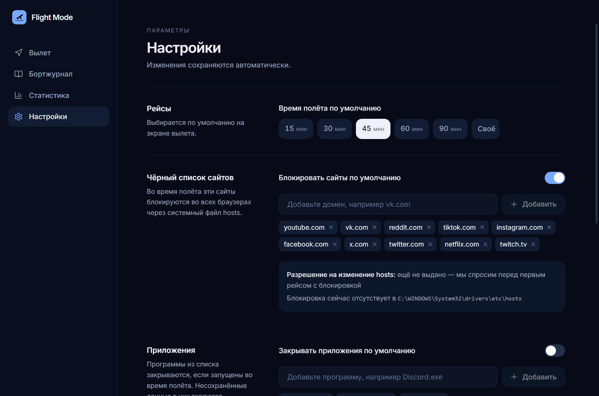

# Flight Mode

**Хватит откладывать. Взлетайте. Доделайте главное.**

Flight Mode — приложение для фокусировки под Windows. Выберите одно дело, которое давно откладываете, «взлетите» и оставайтесь в полёте до посадки. Пока идёт рейс, отвлекающие сайты и программы блокируются — настолько, насколько это честно позволяет Windows.

**[⬇ Скачать последнюю версию](https://github.com/arbeiterschaft02-prog/flight-mode/releases/latest)** · [История изменений](CHANGELOG.md)



| Авиация | В приложении |
| --- | --- |
| Подготовка к вылету | Название задачи, длительность, проверка блокировок |
| Взлёт | Запускается обратный отсчёт и включается блокировка |
| Полёт | Кабина: таймер, маршрут, статус |
| Турбулентность | Запущена программа из чёрного списка, и её закрыли |
| Аварийная посадка | Досрочное завершение (с подтверждением), рейс записывается как *прерванный* |
| Прилёт | Таймер дошёл до нуля, рейс записывается как *завершённый* |

---

## Установка

1. Скачайте `Flight-Mode-Setup-<версия>.exe` со страницы [Releases](https://github.com/arbeiterschaft02-prog/flight-mode/releases/latest).
2. Запустите установщик. Он без цифровой подписи, поэтому Windows покажет окно «Система Windows защитила ваш компьютер» — нажмите **«Подробнее» → «Выполнить в любом случае»**.
3. На рабочем столе и в меню «Пуск» появится ярлык **Flight Mode**.

Нужна Windows 10 или 11. Права администратора для установки не нужны (установка для текущего пользователя). Удаление — через «Параметры → Приложения».

---

## Возможности

- **Вылет (главный экран):** название задачи, пресеты 15/30/45/60/90 минут и своё время (1–240 мин), кнопка **«Взлететь»**, статистика за сегодня (рейсы, время в фокусе, серия дней) и последние рейсы.
- **Предполётная проверка:** «посадочный талон» (сейчас → время прилёта), включение блокировки сайтов и программ, редактирование списков прямо на месте.
- **Кабина:** большой таймер, задача, анимированный маршрут с самолётом, фаза полёта (взлёт, набор высоты, крейсерский полёт, снижение, заход на посадку), честный статус блокировок, счётчик турбулентности, **Пауза** и **Аварийная посадка** с подтверждением.
- **Прилёт:** поздравление или экран аварийной посадки — задача, фактическое и плановое время, статус, турбулентность; кнопки «Новый рейс» и «Бортжурнал».
- **Бортжурнал:** все завершённые и прерванные рейсы (задача, дата и время, план, факт, статус), группировка по дням, фильтр, удаление записей.
- **Статистика:** фокус за неделю и сегодня, серия дней, график за 7 дней, общее время, доля завершённых рейсов, средний и самый длинный полёт.
- **Настройки:** чёрный список сайтов, список программ, длительность по умолчанию, звуки (сигналы, громкость, шум салона), уведомления (посадка, взлёт, турбулентность), тема (тёмная, светлая, системная), разрешение на изменение hosts и кнопка «Снять блокировку».
- **Надёжность:**
  - Таймер считается от отметок времени, поэтому переживает сворачивание, сон компьютера и перезапуск.
  - Рейс восстанавливается после перезапуска приложения; если он закончился, пока приложение было закрыто, — засчитывается посадка.
  - Данные пишутся атомарно; повреждённый файл данных сохраняется в резервную копию, а не роняет приложение.
  - Ошибка в интерфейсе не ломает всё приложение.
  - Закрыть окно во время полёта можно всегда — приложение объяснит последствия, но не помешает.

<table>
  <tr>
    <td></td>
    <td></td>
  </tr>
  <tr>
    <td></td>
    <td></td>
  </tr>
  <tr>
    <td></td>
    <td></td>
  </tr>
</table>

---

## Как работает блокировка

### Сайты — системный файл hosts

Flight Mode добавляет в `C:\Windows\System32\drivers\etc\hosts` помеченный раздел, который направляет каждый домен из чёрного списка (вместе с вариантами `www.` и `m.`) на `0.0.0.0` / `::`. Это работает во всех браузерах без расширений.

- **Только с явного разрешения.** Перед первым рейсом с блокировкой приложение объясняет, что именно изменит, и спрашивает согласие. Затем Windows показывает запрос прав администратора (UAC). Если отказаться, рейс всё равно начнётся, а приложение прямо скажет, что сайты **не** заблокированы.
- **Проверяется, а не предполагается.** После записи приложение перечитывает файл hosts. Надпись «Заблокировано N сайтов» появляется, только если блокировка действительно на месте.
- **Браузер, открытый много дней.** Свежезапущенный браузер сразу видит блокировку. Но Chrome и другие браузеры на Chromium, проработавшие несколько дней без перезапуска, могут перестать замечать изменения hosts и продолжать узнавать адреса сайтов сами. Поэтому на экране подготовки и в кабине есть кнопка **«Перезапустить браузер»**: после подтверждения приложение через Windows Restart Manager закрывает браузер так же, как Windows при выходе из системы, и сразу запускает его с `--restore-last-session`. Все окна и вкладки возвращаются, пропасть может только неотправленный текст в формах. Поддерживаются Chrome, Edge, Яндекс Браузер, Brave, Opera и Vivaldi. Браузер никогда не перезапускается без нажатия кнопки.
- **Уборка.** После посадки блокировка снимается. При запуске приложение удаляет блокировку, оставшуюся после сбоя. В настройках есть кнопка **«Снять блокировку»**.

### Программы — проверка и закрытие

Если включено, Flight Mode каждые 4 секунды проверяет запущенные процессы (`tasklist`) и закрывает программы из списка (`taskkill`). Каждое закрытие — это **турбулентность**. Несохранённые данные в закрытых программах теряются, поэтому по умолчанию функция **выключена**.

### Ограничения — честно

- **Firefox** кнопка не перезапускает. Если в нём сайт открывается, перезапустите Firefox вручную.
- **Несколько профилей Chrome:** после перезапуска восстанавливается профиль, которым пользовались последним.
- **Защищённый DNS (DoH), VPN и прокси** с удалённым разрешением имён могут обходить файл hosts.
- **Антивирус** может запрещать изменение hosts. Тогда приложение покажет «Сайты не заблокированы».
- **Запрос прав администратора** появляется при каждом взлёте и посадке с блокировкой сайтов, если сам Flight Mode не запущен от администратора.
- **Программы, запущенные от администратора,** не может закрыть Flight Mode, запущенный без этих прав.
- **Если закрыть Flight Mode во время полёта,** таймер продолжает идти, а блокировка сайтов остаётся до следующего запуска — тогда приложение продолжит рейс или засчитает посадку. Это сделано намеренно и объясняется в окне закрытия.

---

## Разработка

Нужны **Windows 10/11**, **Node.js 20+** (проверено на Node 24) и npm.

```bash
npm install
npm run dev        # запуск с горячей перезагрузкой
```

> Если `npm run dev` в терминале VS Code не открывает окно, в этой оболочке, скорее всего, задана переменная `ELECTRON_RUN_AS_NODE`. Выполните `Remove-Item Env:ELECTRON_RUN_AS_NODE` (PowerShell) или используйте обычный терминал.

| Команда | Что делает |
| --- | --- |
| `npm run typecheck` | Строгая проверка типов основного процесса и интерфейса |
| `npm test` | Модульные тесты: таймер, валидация, домены, генерация hosts, статистика |
| `npm run build` | Проверка типов и production-сборка в `out/` |
| `npm start` | Запуск production-сборки |
| `npm run icon` | Перегенерировать `resources/icon.png` из логотипа |
| `npm run dist:win` | Собрать установщик `release/<версия>/Flight-Mode-Setup-<версия>.exe` |
| `npm run dist:dir` | Собрать только распакованное приложение (`release/<версия>/win-unpacked/`) |
| `powershell -ExecutionPolicy Bypass -File scripts/e2e.ps1` | Сквозной тест собранного приложения: интерфейс, пауза, аварийная посадка, восстановление после перезапуска, посадка по таймеру, удаление. Скриншоты — в `e2e-screenshots/` |

Данные пользователя хранятся в `%APPDATA%\Flight Mode\flight-mode-data.json` и не удаляются при удалении приложения.

Установщик не подписан. Чтобы подписать, задайте `CSC_LINK` / `CSC_KEY_PASSWORD` для electron-builder.

### Версии и релизы

Проект следует [семантическому версионированию](https://semver.org/lang/ru/): `МАЖОРНАЯ.МИНОРНАЯ.ПАТЧ`. Каждой версии соответствует git-тег `vX.Y.Z` и релиз на GitHub с установщиком.

Как выпустить новую версию:

1. Перенести пункты из раздела «Не выпущено» в [CHANGELOG.md](CHANGELOG.md) под новый номер версии с датой.
2. Поднять версию и создать тег (`patch` — исправления, `minor` — новые функции, `major` — несовместимые изменения):
   ```bash
   npm version patch -m "Release v%s"
   ```
3. Собрать установщик и опубликовать релиз:
   ```bash
   npm run dist:win
   git push --follow-tags
   gh release create v0.1.1 release/0.1.1/Flight-Mode-Setup-0.1.1.exe --title "Flight Mode 0.1.1" --notes-file <заметки>
   ```

---

## Архитектура

```
electron/
  main/
    index.ts          Жизненный цикл, единственный экземпляр, события питания
    window.ts         Окно, заголовок, запрет навигации, диалог закрытия во время полёта
    ipc.ts            Типизированные IPC-обработчики с валидацией (единственный вход для интерфейса)
    store.ts          JSON-хранилище: атомарная запись, очистка схемы, резервная копия при повреждении
    flightService.ts  Жизненный цикл рейса: взлёт, пауза, посадка, восстановление, таймер посадки
    siteBlocker.ts    Блокировка через hosts: сборка, запись с повышением прав, проверка, снятие
    appBlocker.ts     Проверка и закрытие программ во время полёта
    browserRestart.ts Перезапуск браузеров с сохранением вкладок (Windows Restart Manager)
    notifier.ts       Уведомления Windows
  preload/
    index.ts          API через contextBridge (window.flightMode), в песочнице
src/
  types/              Общие типы и контракт IPC
  utils/              Чистая логика: таймер, валидация, статистика, время, домены, склонения
  services/           api.ts (шлюз IPC), sound.ts (синтезированные звуки Web Audio)
  store/              Состояние приложения на Zustand
  hooks/              useNow, useFlightClock, useCabinAmbience
  components/         Переиспользуемые элементы: Button, Toggle, Dialog, DurationPicker, FlightPath, WeekChart…
  layouts/            AppLayout: боковая панель, заголовок, значок полёта
  pages/              Вылет, Подготовка, Кабина, Прилёт, Бортжурнал, Статистика, Настройки
  styles/             Tailwind и токены темы (CSS-переменные для тёмной и светлой)
tests/                Модульные тесты (node:test)
scripts/              Сквозные тесты, генератор иконки
docs/screenshots/     Скриншоты для README
```

**Принципы**

- **Привилегированная работа — только в основном процессе:** файлы, hosts, процессы и уведомления. Интерфейс работает с `contextIsolation`, `sandbox` и без Node, общается с основным процессом только через типизированный API. В production-сборку встраивается строгая CSP.
- **Таймером владеет основной процесс.** Он планирует посадку, даже когда окно скрыто. Интерфейс только показывает значения, вычисленные из отметок времени.
- **Общая логика — чистый TypeScript** (`src/utils`, `src/types`), используется обоими процессами.
- **Хранилище спрятано за одним классом** (`DataStore`), его можно заменить на SQLite или синхронизацию, не трогая интерфейс.

**Стек:** Electron 33, React 18, TypeScript 5.6, Vite 5 (electron-vite), Tailwind CSS 3, Zustand, lucide-react, electron-builder (NSIS).

## Не входит в MVP (намеренно)

ИИ-ассистент, аккаунты, облачная синхронизация, социальные функции, платежи, сложная геймификация, мобильные приложения.

## Возможные следующие шаги

- Расширение для браузера (Chromium/Firefox) для блокировки по вкладкам без прав администратора.
- Небольшая служба Windows, которая меняет hosts без запроса UAC каждый раз.
- Значок в трее с мини-таймером и глобальная горячая клавиша для взлёта.
- Экспорт данных (CSV/JSON) и сборка под macOS.

## Лицензия

[MIT](LICENSE)
